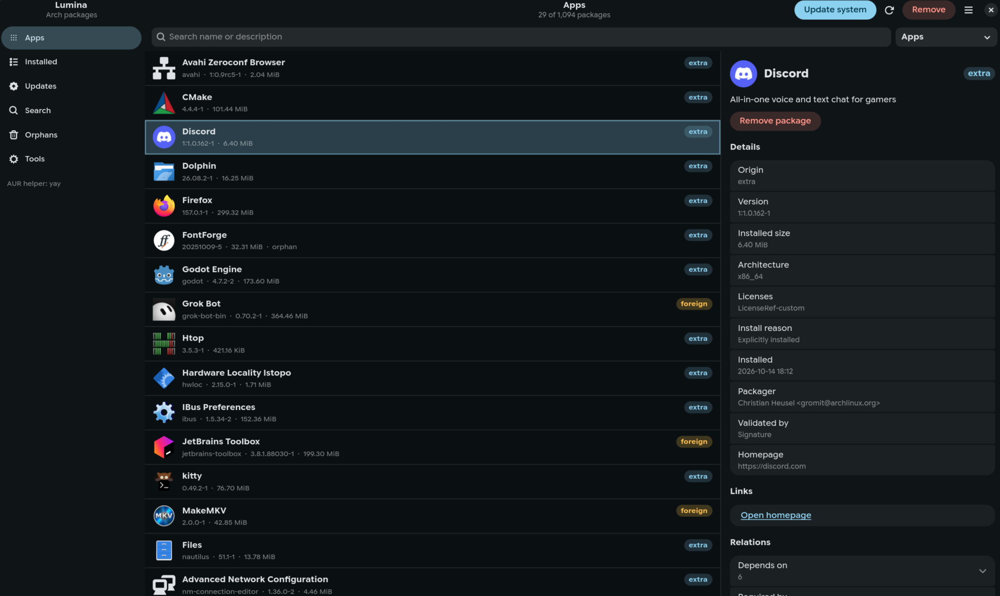
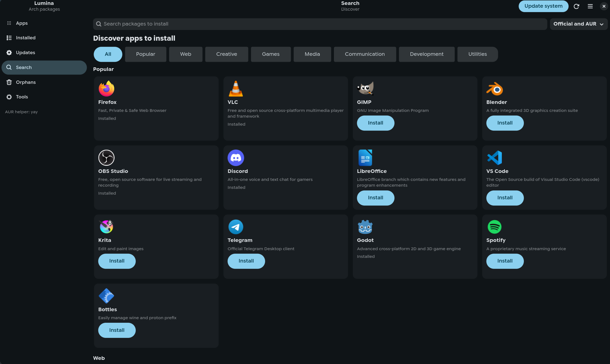
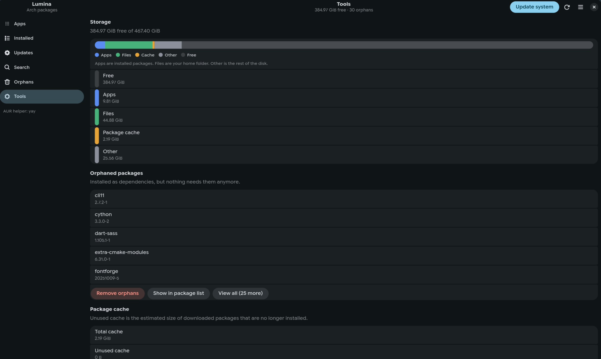
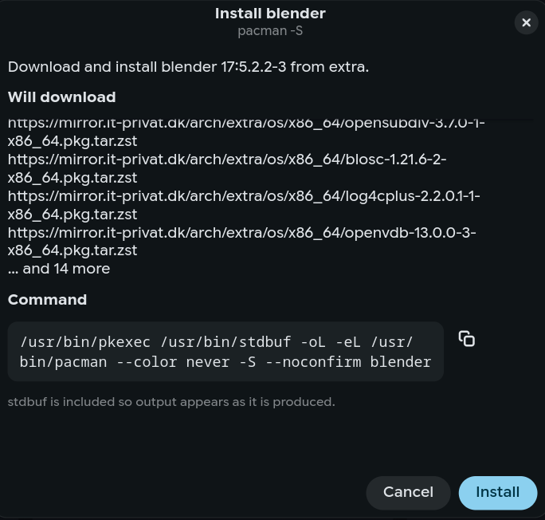
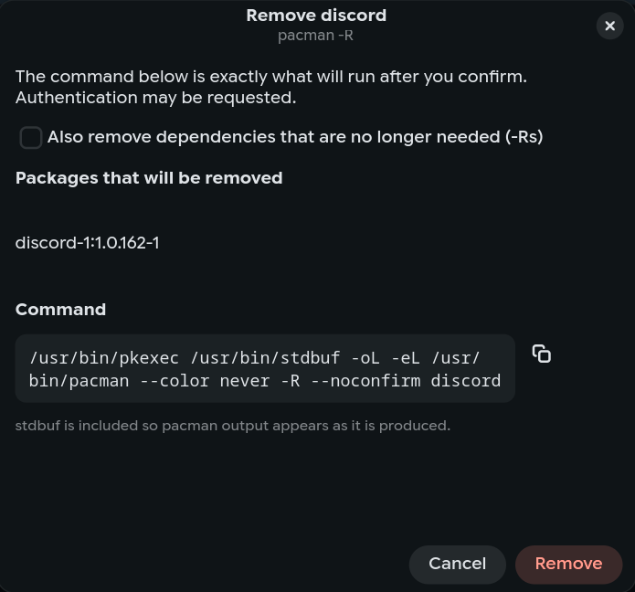

<p align="center">
  
</p>

<h1 align="center">Lumina</h1>

<p align="center">
  <strong>The best GUI for pacman, the AUR, and paru.</strong><br>
  Official repos through pacman. The AUR through paru, or yay if that is what you have.<br>
  The command is on screen before it runs.
</p>

<p align="center">
  
  
  
</p>

<p align="center">
  <a href="https://lumina.0ls3n.dk">lumina.0ls3n.dk</a>
  ·
  <a href="https://github.com/0ls3n/Lumina">GitHub</a>
</p>

```sh
curl -fsSL https://lumina.0ls3n.dk/install.sh | bash
```

Not on the AUR yet. That one line installs the libraries, the `lumina` command, the desktop entry, and the icon.

<p align="center">
  
</p>

Pamac looks finished and keeps the pacman line to itself. Octopi has been around for years and still does not show the argv. GNOME Software and Discover are app stores. The terminal still does the whole job. Lumina is the list, the filters, and the details, with the command left where you can read it.

## Why this one

<table>
  <tr>
    <td width="33%" valign="top">
      <h3>You see the line</h3>
      Install, remove, and update show the exact command. You confirm it. <code>--noconfirm</code> is added only after that. The log is stdout and stderr, not a progress bar standing in for the process.
    </td>
    <td width="33%" valign="top">
      <h3>pacman and the AUR</h3>
      Official packages need no helper. The AUR uses paru if it is installed, otherwise yay. One window for both, with origin on every row.
    </td>
    <td width="33%" valign="top">
      <h3>Built for the desktop</h3>
      GTK4 and libadwaita. Hyprland and KDE. A polkit agent, then <code>pkexec</code>. Window size and the last filter stay in <code>~/.config/lumina/config.json</code>.
    </td>
  </tr>
</table>

## The window

**Installed.** Name, version, size, origin. Filters for explicit, official, AUR, and orphans. The side panel has the description, dependencies, required-by, homepage, and licenses.

**Updates.** Pending upgrades from the repos and the AUR. Update the system, sync the databases, or upgrade one package. The line is whatever pacman or your helper would run.

<p align="center">
  
</p>

**Discover.** Common apps, with icons, grouped into web, creative, games, media, and development. Search is there if you already know the package name.

<p align="center">
  
</p>

**Tools.** Orphans, cache size, and a disk bar for apps, files, cache, and free space. Cleaning any of that still shows the command first.

<p align="center">
  
  &nbsp;
  
</p>

## Install

```sh
curl -fsSL https://lumina.0ls3n.dk/install.sh | bash
```

| | |
| --- | --- |
| Every user, under `/usr/local` | `curl -fsSL https://lumina.0ls3n.dk/install.sh \| bash -s -- --system` |
| Remove the current-user install | `curl -fsSL https://lumina.0ls3n.dk/install.sh \| bash -s -- --uninstall` |
| From this checkout | `./install.sh` |

Then:

```sh
lumina
```

From a checkout, without installing: `python -m lumina`.

`~/.local/bin` has to be on `PATH`. The installer says so if it is not.

## Shortcuts

| Key | |
| --- | --- |
| `Ctrl+F` | Search |
| `F5` | Refresh |
| `Delete` | Remove the selected package. Ignored while typing. |
| `Ctrl+Q` | Quit |

## Requirements

Arch, or an Arch-based system. `python`, `python-gobject`, `gtk4`, `libadwaita`, `pacman`, and `polkit` (`pkexec`, plus a graphical agent). `paru` or `yay` is optional.

Removal needs a running polkit agent. On Hyprland that is often `polkit-kde-agent`.

## Tests

```sh
python -m unittest discover -s tests
```
